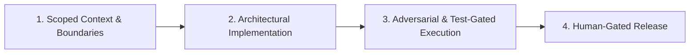

# Lukas Prinsloo (Luke)

**Platform Engineer · Distributed Systems & Cloud Estates**
Cape Town, South Africa (`UTC+2` · UK/EU & US East Coast overlap)

> **Engineering software to solve artificially generated problems.**
> Owning complex work end to end, turning abstract problems into platforms that are consistent for users and flexible for admins. Built around systems reliability, delivery speed, and production ownership first, with governed multi-agent execution as the force multiplier underneath.

[**Portfolio & AI Agent (`thisisluke.dev`)**](https://thisisluke.dev) · [**Download CV (PDF)**](https://thisisluke.dev/Luke-Prinsloo-CV.pdf) · [**LinkedIn**](https://www.linkedin.com/in/this-is-luke-dot-dev/) · [**Good Game Anvil (`goodgameanvil.com`)**](https://goodgameanvil.com)

---

### CTO Endorsement & Production Impact

> *"Nothing he has taken ownership of has needed chasing. Where many developers wait for direction, Luke identifies what needs to happen, takes responsibility for the outcome, and drives it to completion."*
> **[Daniel Pettifor](https://www.linkedin.com/in/danielpettifor/)**, CTO & Principal Architect, Inner Reality (20 August 2026)

- **Over 60% of production releases in a multi repo estate**
- **Built scalable systems that can serve 200k users comfortably**
- **3 roles, 2 promotions in 2 years at the same company** (Software QA Engineer, Jul 2023 to May 2024 · Frontend Engineer, Jun 2024 to Jun 2025 · Platform Engineer, Jun 2025 to Present)
- **Commercial Gravity:** Production campaigns across F1 motorsport, betting, retail, banking, and FMCG underpinned **R2.4m in player deposits**, **over 6,650 leads**, and a **40% voucher redemption rate** on a national radio and AR campaign.

*(Commercial and production codebases live inside private organisation repositories across **Inner Reality**, **Good Game Anvil**, and **SRP** to protect client and platform IP.)*

---

### How Delivery Works: Research, Architecture, Governed Execution

In practice, **Responsibility as a Service (RaaS)** means answering for what reaches production. Velocity without boundaries creates context drift across repositories, silent regressions, and changes outrunning human verification. Delivery stays reliable when systems thinking leads and automation runs inside strict guardrails:

- **01 · Research and Context Design:** Work starts with codebase reconnaissance, clear acceptance contracts, scoped contexts, and explicit repository write boundaries. Every client and product estate operates behind deterministic AWS IAM boundaries so credentials and context never bleed across environments.
- **02 · Architectural Implementation:** Systems are designed around atomic state transitions, single-writer domain authorities, strict tenant isolation, and fail-closed infrastructure policies so services scale independently under burst traffic and recover predictably when dependencies degrade.
- **03 · Agentic Delivery with Governance and Audits:** Complexity-routed multi-model orchestration executes bounded implementation units, backed by adversarial code review, automated Playwright and unit test gates, human architectural sign-off, and human-gated production releases.

---

### Selected Work

#### 01 · [Inner Reality](https://innereality.com)
**Platform Engineer · Jul 2023 to Present · Direct to the CTO**

Enterprise 3D, WebAR, and gamified brand campaign platform with native WhatsApp integration that passed a security audit, powering commercial campaigns across F1 motorsport, betting, retail, banking, and FMCG (**R2.4m in player deposits**, **over 6,650 leads**, and a **40% voucher redemption rate**).

- **16-Day WebAR Vendor Rescue:** When the core WebAR vendor issued a three-day shutdown notice, built and shipped a zero-licensing-cost React, 8th Wall, and WebXR replacement from scratch in 16 days, keeping active enterprise client contracts live without interruption. Also helped take the four-step 3D Campaign Studio to production and built Inner Reality's automated Python, SeleniumBase, and Playwright test suite from nothing.
- **Atomic Prize Allocation:** Designed and built round-based prize rationing using DynamoDB conditional transactions (`TransactWriteItems`) alongside Valkey and Lua leasing to prevent double-awards and over-allocation under burst traffic.
- **Partner M2M API:** Built an OAuth 2.0 `client_credentials` partner ingress API for a Global Motorsport Partner (sized for bursts of 200k players) with per-campaign scope enforcement, atomic single-use launch-link burning (`410 Gone` replay protection), and native app or WhatsApp deep-link return flows.
- **Fail-Closed Release Engineering:** Co-built a multi-account AWS and OpenTofu deployment estate with a fast dev component delta lane (Lane 1), immutable preprod-to-prod promotion (Lane 2), saved-plan enforcement, intent-based plan policies, and state-ownership collision detection.

#### 02 · [Good Game Anvil](https://goodgameanvil.com)
**Co-Founder · Live Platform**

Co-founded and built a platform that keeps competitive gaming fair when players compete from around the world. Pairs Discord clan registration, map vetoes, and scheduling alongside a web portal; vision and OCR scoreboard verification (`AWS Bedrock` and `Tesseract`) checked against deterministic rules with human review for uncertain reads; and strict tenant isolation and POPIA-aligned consent flows on AWS (`Lambda`, `HTTP API Gateway`, `TypeScript`, single-table `DynamoDB`).

#### 03 · SRP (Scientific Research Platform) & Arbiter
**Co-Founder · Built with Daniel Pettifor · In Build**

- **Scientific Research Platform (SRP):** Co-founding a Scientific Research Platform bringing Good Laboratory Practice (GLP) compliance to agentic project oversight, featuring consent-gated local meeting capture (`Faster-Whisper`, `pyannote`, and `Gemma` via `Ollama` in `<0.5s` and `<5GB VRAM`, zero raw audio leaving the device).
- **Arbiter: Proof Before Trust:** Agent harness in active development inside SRP (a work in progress). Every change gets a goal, a write boundary, and a test that must fail before it passes, recorded in a hash-linked, append-only ledger with automatic rollback on failed proof.

---

### Tools & Foundations

- **Frontend & Spatial Web:** TypeScript, React, Vue 3, Vite, Three.js, A-Frame, 8th Wall WebXR, MindAR, PlayCanvas.
- **Backend & Data:** Node.js, Python, TypeScript, REST APIs, OAuth 2.0, WebSockets, DynamoDB, Valkey, Lua, S3, OpenSearch.
- **AWS & Infrastructure:** Lambda, API Gateway, CloudFront, Cognito, SES, EventBridge, CloudWatch, IAM, OpenTofu, Terraform.
- **CI/CD & Testing:** GitHub Actions, Playwright, SeleniumBase, Vitest.
- **AI & Agents:** AWS Bedrock, local AI nodes (Faster-Whisper, pyannote, Ollama), Arbiter agent harness, in build (goal contracts, write boundaries, hash linked ledger).

#### Education

- **Software Engineering Certificate:** HyperionDev with Stellenbosch University, 2023 · 99%, Student of the Month
- **Systems & Networking:** CompTIA A+ & N+ (CTU Training Solutions, 2011)
- **Visual & Creative Foundations:** Digital Photography Diploma · 12 years of graphic design and commercial photography
