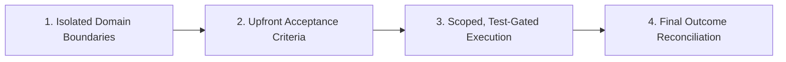

# Lukas (Luke) Prinsloo

**Full-Stack Engineer | Platforms & Products · Responsibility as a Service (RaaS)**
Cape Town, South Africa (`UTC+2` · UK/EU & US East Coast overlap)

> **I own complex work end to end, from initial friction to production outcomes.**
> I take abstract problems and build systems that deliver consistency for users and control for admins.

[**Portfolio & AI Agent (`thisisluke.dev`)**](https://thisisluke.dev) · [**1-Page CV (PDF)**](https://thisisluke.dev/Luke-Prinsloo-CV.pdf) · [**LinkedIn**](https://www.linkedin.com/in/this-is-luke-dot-dev/) · [**Good Game Anvil (`goodgameanvil.com`)**](https://goodgameanvil.com)

---

### CTO Endorsement & Production Telemetry

> *"Nothing he has taken ownership of has needed chasing. Where many developers wait for direction, Luke identifies what needs to happen, takes responsibility for the outcome, and drives it to completion."*
> **[Daniel Pettifor](https://www.linkedin.com/in/danielpettifor/)**, CTO & Principal Architect, Inner Reality (20 August 2026)

- **62% of Total Engineering Delivery & Production Releases** across a 31-repository commercial AWS estate (*Six Month Telemetry Snapshot · Inner Reality, Jul 2025 to Present*).
- **Rapid Progression:** Software QA Engineer (`Jul 2023`) → Frontend Engineer (`Jun 2024`) → Platform Engineer (`Jun 2025 to Present`).

*(Note: My commercial and production codebases live inside private organization repositories across **Inner Reality**, **Good Game Anvil**, and **SRP** to protect client and platform IP.)*

---

### High-Level Philosophy: Governed Multi-Agent Orchestration (The Loom)

Velocity without governance is a liability. Unchecked AI-assisted coding often fails in production for predictable reasons: context drift across repositories, silent regressions, and speed outrunning human verification.

While learning to code, I visualized software as individual threads interlocking into fabric, much like the **1804 Jacquard loom** that pioneered punched-card programming. To deliver consistently at scale across a 31-repository cloud estate, I built **The Loom** as an internal engineering orchestration layer around four high-level principles:

1. **Strict Client & Domain Isolation:** Every product and client estate operates inside an isolated boundary with explicit repository and deployment guardrails, ensuring context and credentials never bleed across environments.
2. **Upfront Architectural Intent:** Work begins by defining clear acceptance criteria and evaluating security, data, privacy, and rollback risks before implementation starts.
3. **Scoped, Traceable Execution:** Rather than relying on long, drifting chat sessions, complex features are broken into small, independent units of work backed by automated test-first verification (proving a failure before proving the fix).
4. **Reconciliation Against Original Outcomes:** Every deliverable is verified against its original acceptance criteria and pre-release security gates before shipping to production.

---

### Three Pillars of Delivery

- **01. End-to-End Delivery:** Taking commercial and technical briefs from a blank repository to a verified live release across interface, backend services, and cloud infrastructure.
- **02. Event-Driven Architecture:** Designing systems around atomic state transitions, single-writer domain authorities, and strict tenant isolation so services scale independently and fail safely.
- **03. Management & Auditing:** Building systems with availability, traceability, and administrative control baked in from day one.

---

### Flagship Production Systems

| System | Role | What It Is & Solves | Core Stack |
| :--- | :--- | :--- | :--- |
| **[Inner Reality](https://innereality.com)** | Platform Engineer | Enterprise 3D, WebXR, and gamified brand campaign platform powering high-traffic mobile experiences and interactive games. Shipped a partner API in 2 days for a Global Motorsport Partner (300k player bursts), authoritative prize/budget failsafes, the 4-step 3D Campaign Studio, and a 7-day WebXR rebuild. | React, Vue 3, Node.js, Python, TypeScript, Three.js, AWS (CDK, Terraform, Lambda, DynamoDB, CloudFront, WAF) |
| **[Good Game Anvil](https://goodgameanvil.com)** | Founder & Principal Architect | Live multi-tenant esports and gaming community operations platform operating natively inside Discord alongside a web portal, automating clan rosters, scheduling, and OCR scoreboard verification (`4,300+` automated tests). | AWS Serverless (CDK, TypeScript, Lambda, HTTP API Gateway), Single-Table DynamoDB, Discord HTTP, AWS Bedrock & Textract |
| **SRP & The Loom** | Co-Architect | Good Laboratory Practice (GLP) compliant scientific assistance platform pairing consent-gated on-device AI nodes (`<500ms` latency, zero raw audio cloud leakage) with governed engineering orchestration. | Python, Faster-Whisper, pyannote, Gemma / Ollama, AWS (Cognito, DynamoDB, Bedrock, CloudFront) |

---

### Education & Foundations

- **Software Engineering Certificate** (99%, Student of the Month · HyperionDev with Stellenbosch University, 2023)
- **CompTIA A+ & N+** (CTU Training Solutions, 2011)
- **Digital Photography Diploma** (2012 · 12 years of graphic design and commercial photography)
